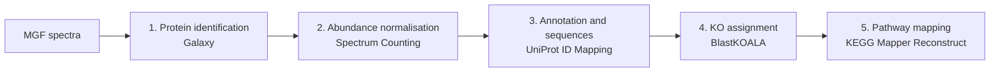

# Proteomics and Metabolic Pathway Analysis

Comparative proteomics of a syntrophic microbial co-culture grown on two long-chain fatty acids.

The co-culture pairs *Syntrophomonas zehnderi* (DSM 17840), which degrades long-chain fatty acids into acetate and hydrogen, with *Methanobacterium formicicum* (DSM 1535), which consumes that hydrogen to reduce CO₂ to methane. One culture grew on **oleate** (unsaturated) and the other on **stearate** (saturated). This repository identifies the proteins in each sample, compares their relative abundances, and maps them onto KEGG pathways to discuss how the growth substrate may shape each organism's metabolism.

| Sample   | Substrate | MGF files       |
| -------- | --------- | --------------- |
| Sample 1 | Oleate    | `F01` to `F24`  |
| Sample 2 | Stearate  | `F73` to `F96`  |

## Pipeline



| Step | What it does | Tool | Output |
| ---- | ------------ | ---- | ------ |
| 1 | Identify and validate proteins per sample, using the same database and parameters for both | Galaxy (SearchGUI, PeptideShaker) | [`results/01-protein-identification`](results/01-protein-identification) |
| 2 | Remove cRAP contaminants and express each protein's Spectrum Counting as a percentage of the sample total | Spreadsheet | [`results/02-03-abundance-annotation`](results/02-03-abundance-annotation) |
| 3 | Retrieve names, organism, function, GO terms, EC numbers and FASTA sequences, split by organism | Galaxy (Query Tabular, UniProt) | [`results/02-03-abundance-annotation`](results/02-03-abundance-annotation) |
| 4 | Assign KEGG Orthology (K number) identifiers, per organism and per condition | BlastKOALA | [`results/04-blastkoala`](results/04-blastkoala) |
| 5 | Map K numbers onto KEGG pathways and interpret them against the abundance data | KEGG Mapper | [`results/05-kegg-reconstruct`](results/05-kegg-reconstruct), [`report`](report) |

Steps 1 to 3 run as Galaxy workflows. Steps 4 and 5 are done manually on the KEGG web services, following the [assignment guidelines](docs/assignment-guidelines.pdf).

## Repository layout

```text
.
├── docs/
│   └── assignment-guidelines.pdf        # Assignment brief
├── inputs/                              # Galaxy inputs (Git LFS)
│   ├── SAMPLE-1-mgf-Oleate.zip
│   ├── SAMPLE-2-mgf-Stearate.zip
│   └── crap_ccp.fasta                   # cRAP contaminant database
├── workflows/
│   ├── 01-protein-identification.ga     # SearchGUI + PeptideShaker: spectra to Protein Report
│   └── 02-post-identification.ga        # Filtering, UniProt retrieval, split by organism
├── results/
│   ├── 01-protein-identification/       # PeptideShaker Protein Reports
│   ├── 02-03-abundance-annotation/
│   │   ├── oleate/                      # UniProt annotations + FASTA per organism
│   │   └── stearate/
│   ├── 04-blastkoala/
│   │   ├── oleate/{m-formicicum,s-zehnderi}/
│   │   └── stearate/{m-formicicum,s-zehnderi}/
│   └── 05-kegg-reconstruct/
└── report/
    └── pathway-section/                 # Typst source and KEGG map figures
```

Proteins retrieved per organism and condition (UniProt FASTA):

| Organism | Oleate | Stearate |
| -------- | -----: | -------: |
| *M. formicicum* | 48 | 25 |
| *S. zehnderi*   | 15 | 4 |

## Reproducing the analysis

1. Install [Git LFS](https://git-lfs.com) and clone the repository so the MGF archives download:

   ```bash
   git lfs install
   ```

   ```bash
   git clone https://github.com/diogocsilva12/proteomics-metabolics-analysis.git
   ```

2. In [Galaxy](https://galaxyproject.org), import both files from `workflows/` (Workflows, Import).
3. Upload the MGF files from `inputs/`, the `crap_ccp.fasta` contaminant database, and the protein sequence database (`database.fasta`, available on Blackboard).
4. Run `01-protein-identification.ga` once per sample, then `02-post-identification.ga` with both Protein Reports.
5. Continue with steps 2 to 5 from the table above.

## Building the report section

The pathway section is written in [Typst](https://typst.app):

```bash
typst compile report/pathway-section/section.typ
```

## Notes on interpretation

- Relative abundance describes each protein's share of the detected profile. A protein not detected in one sample is not necessarily absent.
- A protein mapped to a pathway does not show that the whole pathway was detected or is active.
- Stearate had far fewer confidently identified proteins than oleate, which limits substrate comparisons.

## License

[Apache License 2.0](LICENSE). KEGG map images © Kanehisa Laboratories.
